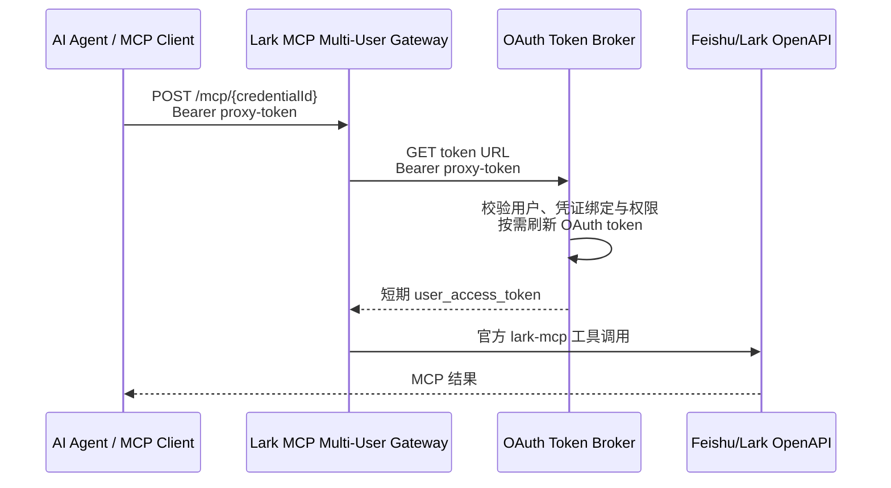

# Lark MCP Multi-User Gateway

[English](README_EN.md)

面向多用户 AI 平台的飞书/Lark MCP 身份网关。它复用飞书官方的
[`@larksuiteoapi/lark-mcp`](https://github.com/larksuite/lark-openapi-mcp)，在 MCP 客户端与
平台的 OAuth Token Broker 之间增加一层无状态的凭证隔离。

官方 MCP 已经负责工具定义、MCP 协议和飞书 OpenAPI 调用。本项目解决托管平台中的另一个问题：
多个用户共用一个 MCP 服务时，如何让每次调用安全地使用调用者自己的短期
`user_access_token`，同时不把真实的 access/refresh token 放进智能体。

> 本项目不是飞书官方项目。飞书/Lark 及相关商标归其权利人所有。

## 工作方式



网关不保存用户令牌，也不负责 OAuth 登录页面。OAuth 授权、refresh token 加密存储、续期、撤销和
审计由 Token Broker 负责。这样可以横向扩容网关，并让平台随时撤销某个用户或智能体的访问权限。

## 适用场景

- SaaS 或企业 AI 平台需要为多个用户提供飞书 MCP。
- 每个用户需要使用自己的飞书身份和权限。
- 智能体只能持有可撤销的代理令牌，不能接触真实飞书令牌。
- OAuth 生命周期已经由现有平台、凭证服务或密钥服务管理。

如果只是个人在本机使用飞书 MCP，直接使用
[`lark-openapi-mcp`](https://github.com/larksuite/lark-openapi-mcp) 会更简单。

## 快速开始

要求 Node.js 20+，以及一个符合[Token Broker 协议](docs/token-broker-contract.md)的 HTTP 服务。

```bash
cp .env.example .env
# 编辑 .env，填写飞书应用和 Token Broker 配置
docker compose up --build
```

服务启动后：

```bash
curl http://localhost:3000/healthz
curl http://localhost:3000/readyz
```

给 MCP 客户端配置一个用户专属入口：

```json
{
  "mcpServers": {
    "feishu": {
      "type": "http",
      "url": "https://mcp.example.com/mcp/credential-123",
      "headers": {
        "Authorization": "Bearer <revocable-proxy-token>"
      }
    }
  }
}
```

`credential-123` 是 Token Broker 认识的凭证标识。代理令牌必须只能访问与它绑定的凭证；不能只依赖
URL 中的 `credentialId` 做授权。

## 配置

| 环境变量 | 必填 | 默认值 | 说明 |
|---|---:|---|---|
| `LARK_APP_ID` | 是 | — | 飞书/Lark 企业自建应用 App ID |
| `LARK_APP_SECRET` | 是 | — | 应用 App Secret |
| `TOKEN_BROKER_URL_TEMPLATE` | 是 | — | Token Broker URL，必须包含 `{credentialId}` |
| `LARK_OPENAPI_BASE_URL` | 否 | `https://open.feishu.cn` | Lark 国际版使用 `https://open.larksuite.com` |
| `LARK_MCP_TOOLS` | 否 | `preset.default` | 逗号分隔的官方 MCP 工具或预设 |
| `LARK_MCP_LANGUAGE` | 否 | `zh` | 工具说明语言：`zh` 或 `en` |
| `TOKEN_BROKER_AUTH_HEADER` | 否 | `Authorization` | 转发代理凭据的请求头 |
| `TOKEN_BROKER_AUTH_SCHEME` | 否 | `Bearer` | 请求头认证 scheme；留空则只发送令牌值 |
| `TOKEN_BROKER_RESPONSE_FIELD` | 否 | 自动识别 | JSON 响应中的字段，支持 `data.access_token` 形式 |
| `TOKEN_BROKER_TIMEOUT_MS` | 否 | `10000` | Token Broker 请求超时毫秒数 |
| `MAX_REQUEST_BODY` | 否 | `4mb` | MCP HTTP 请求体上限 |
| `HOST` | 否 | `0.0.0.0` | 监听地址 |
| `PORT` | 否 | `3000` | 监听端口 |

为了兼容已有集成，`FEISHU_OAUTH_APP_ID`、`FEISHU_OAUTH_APP_SECRET`、
`FEISHU_OPENAPI_BASE_URL`、`FEISHU_MCP_TOOLS` 仍可作为别名；设置
`PLATFORM_API_BASE_URL` 时也会生成旧版 Token Broker 路径。新部署建议使用表中的通用变量。

## HTTP 接口

| 接口 | 用途 |
|---|---|
| `GET /` | 返回服务名称、版本和 MCP 入口格式 |
| `GET /healthz` | 存活探针，不检查外部依赖 |
| `GET /readyz` | 检查必填配置是否合法 |
| `POST /mcp/{credentialId}` | 无状态 Streamable HTTP MCP 入口 |

`credentialId` 可以包含字母、数字、点、下划线、波浪线和短横线，最长 128 个字符。

## 部署

- [Dockerfile](Dockerfile) 使用非 root 用户运行，并包含 OCI 镜像元数据与健康检查。
- [docker-compose.yml](docker-compose.yml) 可用于本地或单机部署。
- [Kubernetes 示例](deploy/kubernetes)包含 Deployment、Service、ConfigMap 和 Secret 模板。
- GitHub Actions 会在 pull request 中运行测试和镜像构建；推送 `v*` 标签时可发布多架构 GHCR 镜像。

公开暴露服务时，应在入口网关配置 TLS、请求大小限制和速率限制。不要记录 Authorization 请求头、
平台代理令牌或 Token Broker 响应。完整安全边界参见 [SECURITY.md](SECURITY.md)。

## 本地开发

```bash
npm ci
npm run check
npm test
npm start
```

项目使用 Node.js 内置测试运行器，不需要额外测试框架。

## 上游与许可证

当前锁定 `@larksuiteoapi/lark-mcp` 版本见 [package.json](package.json)。本项目只封装多租户凭证解析，
飞书工具能力由上游项目提供。

本项目采用 [MIT License](LICENSE)。贡献方式见 [CONTRIBUTING.md](CONTRIBUTING.md)，维护者发布
首个独立仓库和镜像时可按 [RELEASING.md](RELEASING.md) 操作。
